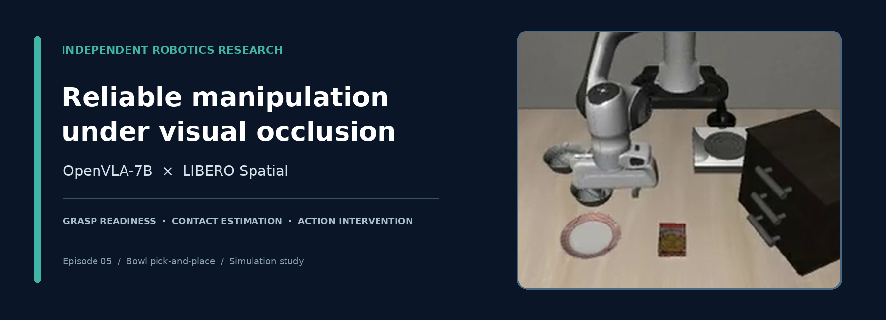
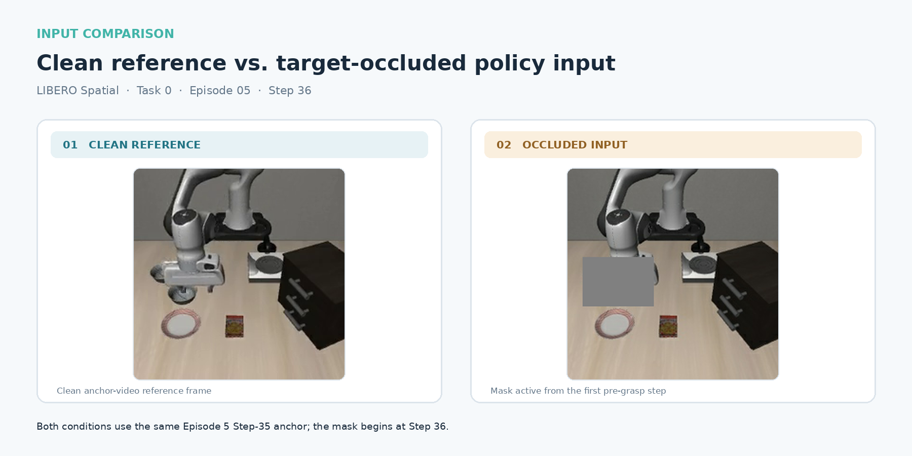
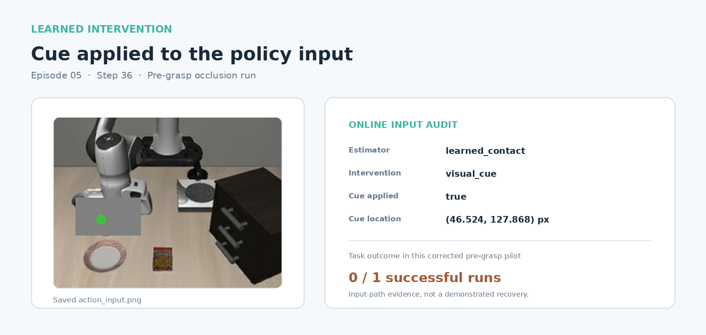

# Reliable Robotic Manipulation under Visual Occlusion

### OpenVLA-7B × LIBERO Spatial · Independent Robotics Research

**Yongzhen Li | November 2026**



This project studies how temporary visual occlusion affects robotic grasping and how lightweight state estimation and action-level interventions can support more reliable manipulation. I built an experimental pipeline around a **frozen OpenVLA-7B policy** in **LIBERO Spatial**, then used controlled occlusion, trajectory-level logging, learned contact-state estimation, and same-state action probes to investigate failure mechanisms around grasp execution.

> **Research focus:** moving from estimating whether an object is already attached to predicting whether a candidate action is likely to produce a stable grasp.

---

## Research questions

1. **Visual robustness:** How does a short, localized loss of target visibility change a VLA policy's manipulation behavior?
2. **State estimation:** Can visual history, robot proprioception, gripper state, and action history provide reliable evidence about contact or attachment?
3. **Grasp readiness:** Can a controller estimate whether closing the gripper *now* is likely to produce a stable grasp, and evaluate alternatives when it is not?

## Experimental setup

| Component | Configuration |
|---|---|
| Foundation policy | OpenVLA-7B, frozen |
| Checkpoint | `openvla/openvla-7b-finetuned-libero-spatial` |
| Benchmark | LIBERO Spatial |
| Task | Task 0: pick up the black bowl between the plate and ramekin and place it on the plate |
| Camera input | 224 × 224 RGB |
| Perturbation | Local RGB masking during selected trajectory windows |
| Evaluation | Environment task-success check, action logs, image-input audits, and offline state traces |

The base VLA policy was not fine-tuned for this study. Occlusion, visual cues, learned estimators, and controller-side interventions were implemented as external experimental components.

## System and engineering contributions

- Built a simulation evaluation pipeline for applying local RGB masks at specified steps and recording the resulting policy inputs.
- Logged **policy-proposed actions separately from executed actions**, making it possible to audit interventions rather than infer them from final motion.
- Added image, metadata, and processor-input records to verify whether a mask or cue actually reached the policy.
- Developed trajectory-level contact/attachment labeling and learned-estimator evaluation with initial-state-level train/validation/test separation.
- Implemented offline target-coverage and temporal-alignment audits using simulator state only for evaluation, not as an online policy input.
- Prototyped a candidate-action interface for investigating grasp readiness and local recovery actions.

## Visual evidence

### Clean reference and target-occluded input



The two frames show the Episode 5 pre-grasp setup at Step 36. The clean reference is taken from the clean anchor preview; the occluded image is the saved masked input from the occlusion run. The runs share the same Step-35 anchor and begin the intervention at Step 36.

### Learned cue in the actual policy input



The saved Step-36 action input and metadata confirm that the `learned_contact` estimator and `visual_cue` intervention were active and that the cue was applied. This is evidence of the input path working—not evidence that the cue recovered the grasp. The corresponding corrected pre-grasp pilot completed **0 of 1** task runs successfully.

## Experimental results and what they establish

### 1. Initial development batch

The initial development batch covered three initial states and five conditions. All 15 recorded runs completed the task:

| Episode | Clean | Occluded | Fixed Hold | Rule Cue | Learned Cue |
|---|---:|---:|---:|---:|---:|
| 3 | 148 steps | 148 | 148 | 148 | 149 |
| 5 | 103 steps | 196 | 99 | 196 | 96 |
| 10 | 116 steps | 120 | 120 | 120 | 120 |

**Interpretation:** this batch demonstrated that the evaluation and intervention pipeline could execute across multiple conditions. A later coverage audit found that, in the original Episode 5 setup, the target-bowl center remained outside the mask during the eight planned masked steps. Therefore, these 15 successful runs do **not** establish a valid target-occlusion effect or a learned-method success-rate improvement.

### 2. Corrected pre-grasp Episode 5 pilot

The masking window was moved to the pre-grasp approach (**Steps 36–51**, inclusive). Offline evaluation confirmed that the target center fell inside the mask during the corrected Occluded and Learned windows. This is a **target-center coverage** check, not a measurement that every bowl pixel was hidden.

The Occluded and Learned runs share the same Episode 5 Step-35 anchor and intervention window, but their configured mask rectangles were not pixel-identical. Treat this as a development comparison, not a perfectly controlled estimate of the effect of the learned cue.

| Condition | Task successes | Runs | Outcome |
|---|---:|---:|---|
| Occluded | 0 | 1 | Failed |
| Fixed Hold | 0 | 1 | Failed |
| Learned visual cue | 0 | 1 | Failed |

The first gripper-close command was recorded at Step 36 for both Occluded and Learned, compared with Step 40 in the clean reference. The learned cue was present in the saved policy input, but it did not change the early closure timing in this episode.

This is a **single-state development result**, not a population-level estimate. The clean reference was not a fully paired successful control within this corrected pilot.

### 3. Learned contact-state estimation

The learning dataset contains **10 trajectories and 1,155 pre-action observation records**. Initial states—not individual frames—were grouped into six training, two validation, and two held-out test groups.

The selected full-feature MLP achieved a validation Brier score of approximately `8.15e-6`. Its held-out behavior was inconsistent:

| Evaluation state | Known hidden labels | Selected MLP Brier score |
|---|---:|---:|
| Episode 2 | 13 | ≈ 1.000 |
| Episode 9 | 37 | ≈ 0.000565 |

Lower Brier scores are better. Episode 9 also contained 15 unknown hidden labels, which were not treated as known outcomes.

**Interpretation:** strong validation performance did not translate consistently to unseen initial states. This motivated a more careful distinction between post-grasp attachment estimation and pre-grasp grasp-readiness prediction. The small held-out set is diagnostic and does not support a generalization claim.

### 4. Same-state candidate-action probes

An eight-candidate probe set was restored from the same Episode 5 pre-grasp state. State restoration was verified for **8/8** candidates. The report recorded **0 positive and 8 negative** sample labels under its lift-proxy criterion.

This probe set did not identify a stable-grasp recovery action. It is a development-only diagnostic—not a trained action scorer, proof of full-task success, or evidence of generalization.

## Research direction: from attachment estimation to grasp readiness

The original learned estimator addressed a post-grasp question:

```text
Is the object already stably attached?
```

The pre-grasp failure analysis suggested a different decision target:

```text
If the gripper closes now, is a stable grasp likely?
```

The proposed prediction target is:

```text
P(stable_grasp | history, close_now)
```

A broader candidate-action formulation is:

```text
Q(history, candidate_action)
    ≈ P(stable_grasp | history, candidate_action)
```

Here, `history` contains only information available to an online controller, such as visual memory, end-effector state, gripper aperture, and action history. The intended controller is **state-conditioned**, not triggered by a fixed occlusion duration or a predetermined step number.

This formulation is a research direction. The current repository contains estimator and controller prototypes, but it does not establish that a trained grasp-readiness policy improves task success.

## Current status and next experiments

The project has established an auditable experimental workflow and identified limitations in the initial learning objective. The next steps are:

1. Collect successful and unsuccessful grasp outcomes across multiple independent initial states.
2. Train a model that scores candidate closure and local movement actions using only online-observable history.
3. Compare learned action selection with fixed-delay and geometric baselines under matched conditions.
4. Separate stable contact, successful lift, and full task completion as distinct outcomes.
5. Report paired success differences and uncertainty across held-out initial states before claiming a success-rate gain.

## Repository structure

```text
experiments/
├── contact_cpu/       # Contact-state analysis and CPU evaluation utilities
├── grasp_v2/          # Grasp-readiness and candidate-action prototypes
├── learned_contact/   # Learned contact / attachment estimation
├── occlusion_eval/    # Masking, evaluation, and offline audits
├── physics_occlusion/ # Physics and occlusion interfaces
└── study_ready/       # Evaluation-integrity and readiness checks

media/                 # Curated figures and demonstration assets
results/               # Selected summaries, comparisons, and reports
README.md
```

## Reproducibility

This repository is a research code and evidence archive, not a turnkey reproduction package. Full execution requires the OpenVLA checkpoint, LIBERO assets, compatible Python/PyTorch dependencies, and an appropriately provisioned GPU environment. Model weights, large raw trajectories, and environment caches are not included.

Selected records and summaries are available under `results/`. Experiment-specific setup notes and tests are located in the corresponding `experiments/` subdirectories.

## Scope and limitations

- The corrected pre-grasp pilot currently contains one run per intervention condition.
- The learned visual cue was verified in the policy input, but did not recover the Episode 5 grasp.
- The selected estimator showed inconsistent performance across the two held-out test states.
- The eight candidate probes produced no positive lift-proxy labels.
- No statistically supported learned success-rate improvement, cross-task generalization, or real-robot result is claimed.

The contribution of this work is the experimental pipeline, input-integrity and target-coverage audits, trajectory-level learning study, failure-driven refinement of the research question, and a concrete action-conditioned formulation for future reliable manipulation research.

## References

- [OpenVLA: An Open-Source Vision-Language-Action Model](https://github.com/openvla/openvla)
- [LIBERO: Benchmark for Lifelong Robot Learning](https://github.com/Lifelong-Robot-Learning/LIBERO)

---

**Yongzhen Li**  
MSc in Data Science, The University of Hong Kong  
Research interests: Embodied AI · Vision-Language-Action Models · Robot Learning · Reliable Manipulation
